# HylMail — Software Architecture

This document is the architectural contract of HylMail: what the system is made
of, which part may call which, and where the trust boundaries run.  It is written
as a **[C4 model](https://c4model.com)** — *Context → Container → Component* —
and is part of the source tree, not a side artifact.

> **Keeping it in sync.**  Any change that adds, removes or re-wires a module
> boundary, a container, a component or a call relationship — a new route,
> store, service, pane, model, a changed dependency direction, a new external
> system — **must** be reflected in the matching diagram below.  A pure
> behaviour change inside an existing component (no new boundary, no new call
> edge) does not need a diagram update.  When in doubt whether a change is
> architecturally significant: update the diagram and say so in the commit
> message.  A diagram that no longer matches the code is worse than no diagram.
>
> `cargo test -p hylmail-cli --test architecture` fails when this document and
> the source drift apart — see [§8](#8-guard-test-and-how-to-update-this-document).

## 0. How to read this document

| Level | Diagram | Question it answers |
|---|---|---|
| **1. Context** | [§1](#1-level-1--system-context) | Who uses HylMail, and which external systems does it talk to? |
| **2. Containers** | [§2](#2-level-2--containers) | Which processes, libraries, stores and channels exist, and how do they talk? |
| **2b. Deployment** | [§2.4](#24-deployment-packaging) | Which artifact lands where on the user's machine? |
| **3. Components** | [§3](#3-level-3--components) | Which modules exist inside each container, and who may call whom? |
| **3.4 Interactions** | [§3.4](#34-interactions-what-happens-on-the-wire) | What is the call order of the four load-bearing flows? |
| **— Rules** | [§4](#4-dependency-laws) | Which dependency directions are law, and where are the trust boundaries? |

**Level 4 (code) is deliberately absent.**  Class and function level diagrams
are generated on demand by the IDE / `rust-analyzer`, by `cargo doc`, and by the
module tables below; a hand-drawn code diagram would be stale within a week.

### Notation

The diagrams are Mermaid `flowchart` and `sequenceDiagram` graphs that carry the
C4 vocabulary in their labels (`[Person]`, `[Software System]`, `[Container]`,
`[Library]`, `[Component]`, `[Store]`).  Mermaid's own `C4Context` renderer is
still marked experimental and is not supported by every forge, so the same model
is drawn with the universally supported syntax — the *levels, boundaries and
relationships* are the C4 ones.  Every structure is also listed in a table next
to its diagram, and those tables are the authoritative detail: the diagram is the
overview.

Two dependency edges are **omitted from the diagrams** for readability, because
they are ubiquitous and carry no design decision:

* every component of `hylmail-core` depends on `models` (the domain types) and on
  `error` (the structured `Error`/`Result` pair);
* every member of the workspace is built against the versions pinned once in the
  root `[workspace.dependencies]` table.

## 1. Level 1 — System Context

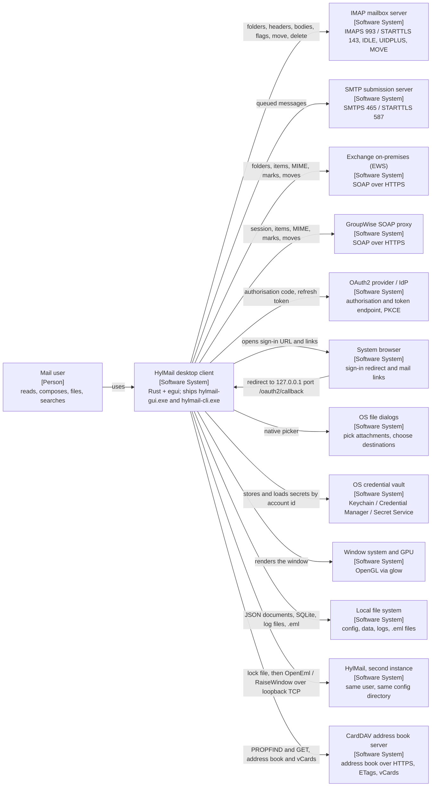

| Counterpart | Kind | What crosses the boundary | Where in the code |
|---|---|---|---|
| Mail user | Person | all input and output; the UI is German | `hylmail-gui` (`view`, `dialogs`) |
| IMAP server | External system | folder list, headers, bodies, flags, moves, deletes; TLS from `net` | `hylmail-core::imap` |
| SMTP server | External system | one message per submission; envelope recipients | `hylmail-core::smtp` |
| Exchange on-premises | External system | EWS `FindFolder`/`FindItem`/`GetItem`, MIME, `UpdateItem`, `MoveItem`, `DeleteItem` | `hylmail-core::ews` |
| GroupWise SOAP proxy | External system | session, paged items, MIME, marks, moves | `hylmail-core::groupwise` |
| OAuth2 provider | External system | PKCE authorisation code, access and refresh token | `hylmail-core::oauth` |
| System browser | External system | the authorisation URL leaves, the code comes back to the loopback listener | `oauth::open_in_browser`, `oauth::Loopback` |
| OS file dialogs | External system | chosen `.eml` files, attachment destinations | `rfd` in `hylmail-gui::state` |
| OS credential vault | External system | passwords and tokens, keyed by account id — never written to any file | `hylmail-core::secrets` |
| CardDAV server | External system | address book discovery (`PROPFIND`), vCards (`GET`) | `hylmail-core::carddav` |
| Window system / GPU | External system | one native window, `glow` OpenGL renderer | `eframe`, `hylmail-gui::lib` |
| Local file system | External system | `settings/accounts/rules/drafts/outbox.json`, `hylmail.sqlite`, `logs/hylmail.log`, `.eml` | `hylmail-core::{paths, store, db, logging}` |
| HylMail, second instance | External system (same product) | `hylmail.lock` plus loopback TCP requests; no mail content | `hylmail-core::ipc`, `hylmail-gui::lib` |

**Trust boundaries.**  (1) Everything that leaves the machine is TLS: the
certificate policy is `TlsPolicy::strict()` unless the user explicitly configures
a cleartext or pinning endpoint.  (2) Secrets only exist in the OS vault and in
process memory; every file on disk references an account by id.  (3) The log
file is written through a redacting formatter.  (4) The inter-process endpoint
binds `127.0.0.1` only and carries commands and a file path, never credentials
and never message content.  (5) Message HTML is hostile input: it is sanitised
against an allow-list, and remote images stay blocked until the user allows them
for that message.

## 2. Level 2 — Containers

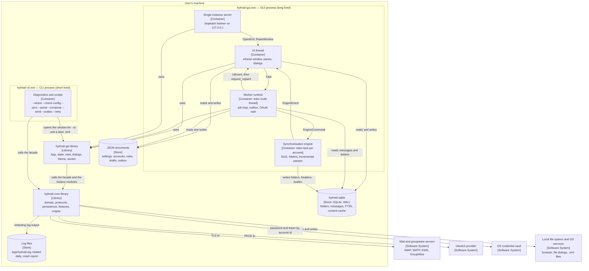

| Container | Technology | Built from | Responsibility |
|---|---|---|---|
| `hylmail-gui.exe` | Rust, native toolchain | bin `hylmail-gui` (`crates/hylmail-cli/src/gui_main.rs`) | desktop entry point; an empty command line opens the window |
| `hylmail-cli.exe` | Rust, native toolchain | bin `hylmail-cli` (`crates/hylmail-cli/src/main.rs`) | diagnostics, scripting, `.eml` hand-off; an empty command line prints the usage text |
| UI thread | `eframe` 0.33 / `egui` 0.33, `glow` OpenGL backend | `hylmail-gui::lib` (`App::update`) | draws the panes, collects `Action`s, never performs network I/O |
| Worker runtime | `tokio` multi-thread runtime, thread name `hylmail-worker` | `hylmail-gui::worker` | one job loop: body fetch, attachment save, flags, delete, move, submit, OAuth sign-in |
| Synchronisation engine | `tokio`, one task per account plus a supervisor | `hylmail-core::sync` | connect, discover folders, incremental passes, `IDLE` or poll, backoff |
| Single-instance server | `std::net` loopback listener, non-blocking | `hylmail-core::ipc` together with `hylmail-gui::lib` | makes a second start hand its `.eml` file to the running window |
| `hylmail-gui` library | Rust library | `crates/hylmail-gui` | UI components; linked into both executables |
| `hylmail-core` library | Rust library | `crates/hylmail-core` | domain types, protocols, persistence, features, engine; **must not depend on any UI** |
| `hylmail.sqlite` | SQLite (bundled `rusqlite`), WAL | `hylmail-core::db` | folders, message headers, cached bodies, FTS5 index, contacts, conversations |
| JSON documents | `serde_json`, written atomically | `hylmail-core::store` | `settings.json`, `accounts.json`, `rules.json`, `drafts.json`, `outbox.json` |
| Log files | `tracing` + a daily rotating appender, redacted | `hylmail-core::logging` | `logs/hylmail.log` rotated daily, plus a pending `absturz.txt` crash report |
| OS credential vault | `keyring`, behind the `SecretStore` trait | `hylmail-core::secrets` | passwords, proxy passwords and OAuth tokens, keyed by account id |

### 2.1 Runtime topology of the GUI process

The window thread owns the `Core` and must never block; everything that can take
a TCP round trip lives on the worker runtime.  The two halves are connected by
four channels, all of them drained **once per frame**:

| Channel | Type | Direction | Backpressure |
|---|---|---|---|
| `Task` | `tokio::sync::mpsc::UnboundedSender` | UI thread → worker | unbounded; the UI can never block on a full queue |
| `UiEvent` | `std::sync::mpsc` | worker → UI thread | unbounded; at most 64 events are drained per frame |
| `EngineCommand` | `tokio::sync::mpsc::UnboundedSender` | UI thread → engine | unbounded; a command to a stopped engine is a logged warning, never a panic |
| `EngineEvent` | `tokio::sync::mpsc::UnboundedReceiver` | engine → UI thread | unbounded; at most 64 events are drained per frame |
| shutdown | `tokio::sync::watch<bool>` | UI thread → engine | the value survives every dropped receiver |
| repaint | `egui::Context` (`Arc`) | worker → UI thread | `request_repaint` after every `UiEvent`; without events the window redraws once per second |

Frame budget: 64 engine events, 64 worker events and the whole single-instance
queue per frame, then the window draws — so a busy mailbox can never starve the
interface.  `Worker::drop` sends `EngineCommand::Shutdown`, closes the job channel and
drops the runtime, which then waits for the blocking tasks.

### 2.2 Where state lives

| State | Home | Lifetime |
|---|---|---|
| Settings, accounts, rules, drafts, outbox | JSON documents | until the next write; re-read by the worker whenever it matters |
| Folders, message headers, cached bodies, FTS index | SQLite | persistent; bodies are evicted by the configured LRU limit |
| Passwords and tokens | OS vault | persistent; never in a file, never in the log |
| Selection, reader, open dialogs, forms | `UiState` in the UI thread | one session |
| Engine and job state | worker runtime | one process |

### 2.3 The single-instance hand-off

Both executables share one startup path, and the single-instance lock lives in
the *window*, not in the launcher — so `hylmail-cli.exe nachricht.eml` and
`hylmail-gui.exe nachricht.eml` behave identically: the first one becomes the
primary and serves, every later one forwards and exits.

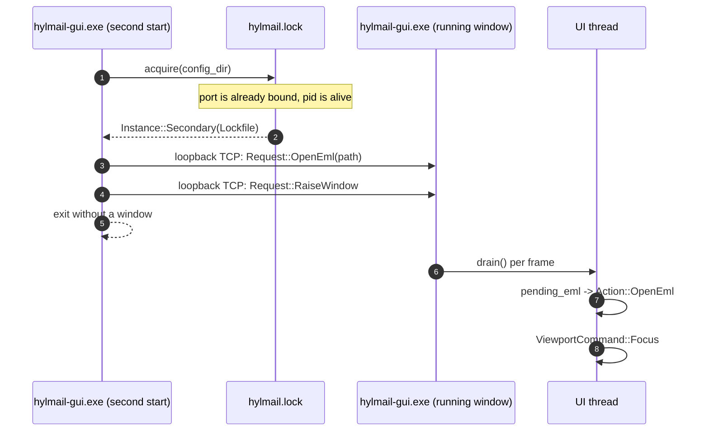

### 2.4 Deployment (packaging)

Not a C4 level of its own, but the same notation answers the question "which
artifact lands where".  Full detail lives in `sys-src/packaging/README.md`.

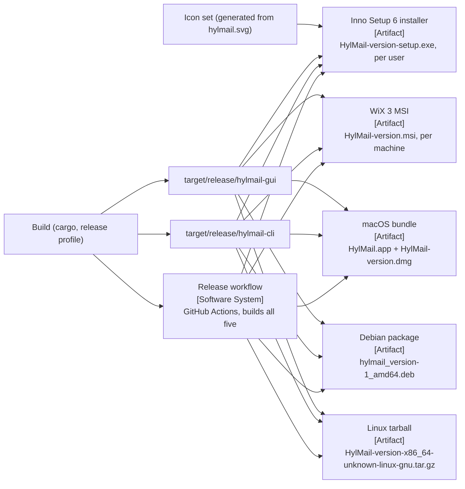

| Artifact | Installs to | Launcher it points at |
|---|---|---|
| `HylMail-<version>-setup.exe` (Inno 6, per user) | `%LOCALAPPDATA%\Programs\HylMail` | `hylmail-gui.exe`, plus a Start-menu and desktop shortcut and the `HylMail.eml` ProgID |
| `HylMail-<version>.msi` (WiX 3, per machine) | `%ProgramFiles%\HylMail` | the same two executables, the same ProgID — only one of the two installers may be installed at a time |
| `HylMail.app` / `.dmg` | `/Applications` (drag and drop) | `Contents/MacOS/hylmail-gui`, universal binary via `lipo` |
| `hylmail_<version>-1_amd64.deb` | `/usr/bin`, `/usr/share/{applications,icons}` | `hylmail-gui` through `de.hylmail.HylMail.desktop` |
| `HylMail-<version>-<triple>.tar.gz` | unpacked by hand | `HylMail-<version>/bin/hylmail-gui` |

## 3. Level 3 — Components

### 3.1 `hylmail-core` — the domain, protocol and process components

```mermaid
flowchart TB
    subgraph domain["Domain and platform"]
        models["models<br/>[Component]<br/>Account, Folder, MessageHeader, MessageBody, Rule, Settings, Draft, ids, presets"]
        paths["paths<br/>[Component]<br/>data locations, portable mode, legacy migration"]
        store["store<br/>[Component]<br/>ConfigStore, atomic JSON documents"]
        db["db<br/>[Component]<br/>Database, migrations, repositories, FTS5, content cache"]
        secrets["secrets<br/>[Component]<br/>SecretStore, KeyringStore, in-memory double"]
        logging["logging<br/>[Component]<br/>redacting tracing layer, crash reports"]
    end

    subgraph transport["Transport"]
        net["net<br/>[Component]<br/>TCP dial, rustls policy, PEM, NTLM"]
        soap["soap<br/>[Component]<br/>XML DOM, SOAP envelopes, HTTPS transport, NTLM handshake"]
        imap["imap<br/>[Component]<br/>connection, capabilities, mailboxes, sync, fetch, flags, IDLE, UTF-7"]
        smtp["smtp<br/>[Component]<br/>submission through lettre"]
        send["send<br/>[Component]<br/>chooses the submitting protocol"]
        ews["ews<br/>[Component]<br/>Exchange Web Services client and synchroniser"]
        gw["groupwise<br/>[Component]<br/>GroupWise SOAP proxy client and synchroniser"]
        carddav["carddav<br/>[Component]<br/>CardDAV address book client and ETag sync"]
    end

    subgraph pipeline["Message pipeline"]
        mime["mime<br/>[Component]<br/>parse, store body, extract attachments"]
        html["html<br/>[Component]<br/>sanitise, image policy, plain text"]
        calendar["calendar<br/>[Component]<br/>text/calendar invitations"]
        image["image<br/>[Component]<br/>SVG rasteriser"]
        body["body<br/>[Component]<br/>on-demand body and attachment download"]
    end

    subgraph features["Features"]
        flags["flags<br/>[Component]<br/>push read and flagged"]
        del["delete<br/>[Component]<br/>move to trash or delete for good"]
        relocate["relocate<br/>[Component]<br/>move into another folder"]
        rules["rules<br/>[Component]<br/>local rule engine"]
        compose["compose<br/>[Component]<br/>draft to MIME, replies, signatures"]
        outbox["outbox<br/>[Component]<br/>queue, retry, drain"]
    end

    subgraph proc["Process and wiring"]
        synceng["sync<br/>[Component]<br/>engine, supervisor, backoff, reconcile"]
        ipc["ipc<br/>[Component]<br/>lock file, loopback requests"]
        oauth["oauth<br/>[Component]<br/>PKCE, loopback callback, token store"]
        bootstrap["bootstrap / Core<br/>[Component]<br/>facade over paths, store, db, secrets, settings"]
    end

    bootstrap --> paths
    bootstrap --> store
    bootstrap --> db
    bootstrap --> secrets
    logging --> paths
    store --> paths
    db --> store

    soap --> net
    imap --> net
    imap --> db
    imap --> secrets
    smtp --> net
    smtp --> secrets
    send --> smtp
    send --> ews
    send --> compose
    ews --> soap
    ews --> db
    ews --> secrets
    gw --> soap
    gw --> db
    gw --> secrets
    carddav --> net
    carddav --> db
    carddav --> secrets
    ews -.->|"reuses sync report types"| imap
    gw -.->|"reuses sync report types"| imap
    ews -.->|"reuse of the reconciler"| synceng
    gw -.->|"reuse of the reconciler"| synceng

    mime --> html
    mime --> calendar
    mime --> db
    html --> image
    image --> net
    body --> imap
    body --> ews
    body --> gw
    body --> mime
    body --> html
    body --> db
    body --> net
    body --> secrets

    flags --> imap
    flags --> ews
    flags --> gw
    del --> imap
    del --> ews
    del --> gw
    relocate --> imap
    relocate --> ews
    relocate --> gw
    compose --> html
    outbox --> compose
    outbox --> store

    synceng --> imap
    synceng --> ews
    synceng --> gw
    synceng --> db
    synceng --> secrets
    synceng --> store
    synceng --> paths
    synceng --> oauth
    oauth --> net
    oauth --> soap
    oauth --> secrets
    ipc --> paths
```

| Component | Owns | May call | Notes |
|---|---|---|---|
| `models` | every domain type, the id newtypes, JSON schema versions, `DomainPreset` | `error` | no I/O and no dependency on any other component |
| `paths` | `AppPaths`, `AppMode` (portable), `Os`, the Windows legacy migration | `error` | the only place that knows where files live |
| `store` | `ConfigStore`, the five documents, atomic writes, `materialise_documents` | `paths`, `models` | the only writer of the JSON documents |
| `db` | `Database` (one `rusqlite` connection behind a lock), migrations, the repositories, FTS5, the LRU content cache, `statistics` | `models` | the only writer of SQLite |
| `secrets` | the `SecretStore` trait, `KeyringStore`, `InMemorySecretStore`, `CredentialKind` | `models` | the only reader/writer of the OS vault |
| `logging` | `init_logging`, `RedactingFormat`/`Redactor`, `trim_log_file`, the crash-report files | `paths`, `models` | redaction happens on the rendered event, so it also covers fields added later |
| `net` | the dialling helpers, `TlsPolicy`/`TlsMode`, PEM handling, `net::ntlm` (`MS-NLMP`: negotiate, challenge, authenticate) | `models` | the single place that decides which certificate store is used; `ntlm` is the one module here that computes rather than dials |
| `soap` | `quick-xml` DOM helpers, envelope builders, the `reqwest` transport with cookies and redirect policy, `HttpClient::ntlm` for the NTLM handshake | `net` | shared by EWS and the GroupWise proxy |
| `imap` | `ImapSession`/`ImapConfig`, capability probing, mailbox names and UTF-7, the folder synchroniser, `FETCH`, flag writes, `IDLE` | `net`, `db`, `secrets`, `models` | also publishes the sync report types (`FolderSyncReport`, `SyncProgress`) that EWS and GroupWise reuse |
| `smtp` | `SmtpConfig`, `submit`, the `lettre` transport | `net`, `secrets`, `models` | no connection pool on purpose: a transport is built per submission |
| `send` | `submit`, `Receipt` | `smtp`, `ews`, `compose`, `models`, `net`, `secrets` | the single dispatch point for submission: picks SMTP for IMAP and GroupWise and EWS for Exchange, and refuses a message without a recipient before any socket is opened |
| `ews` | `EwsClient`/`EwsConfig`, folder and item synchronisation, MIME download, `UpdateItem`, `MoveItem`, `DeleteItem` | `soap`, `db`, `secrets`, `models` | reuses the IMAP sync report types and the shared reconciler by design |
| `groupwise` | `GroupWiseClient`/`GroupWiseConfig`, session handling including `0x4202` re-login, paged `getItemsRequest`, marks, moves | `soap`, `db`, `secrets`, `models` | same reuse as EWS |
| `carddav` | `sync`, the PROPFIND/GET client, the vCard parser, `SyncReport` | `net`, `db`, `secrets`, `models` | ETag change detection; stores the raw vCard verbatim for a lossless round trip |
| `mime` | the `mail-parser` pipeline, `store_body`, `extract_attachments` | `html`, `calendar`, `db`, `models` | turns bytes into a `MessageBody`; never keeps the raw message alive |
| `html` | `HtmlPolicy`, the `ammonia` allow-list, the `cid:` rewrite, plain-text generation, `plain_to_html`, the inline-SVG rasterisation call | `models`, `image` | the reading pane's and the composer's single HTML boundary |
| `calendar` | `parse`, `CalendarSummary`, `build_reply`, `PartStat` | `error` | one `text/calendar` part in, a summary out; a reply back out, reusing the original object |
| `image` | SVG rasterisation, `data:`-URI decoding, remote-image fetching (`fetch_all`), magic-byte `sniff` and raster `decode` | `error`, `net` | turns an inline SVG into a bitmap and loads the remote images the user allowed, so the reading pane never receives a document |
| `body` | `download`, `fetch_raw`, `save_attachments` | the three protocol clients, `mime`, `html`, `db`, `net`, `secrets` | dispatches on `AccountKind`; the only place that turns a header into a rendered body |
| `flags` | `push` | the three protocol clients | dispatches on `AccountKind` |
| `delete` | `delete` with `DeleteMode`, `DeleteOutcome` | the three protocol clients | dispatches on `AccountKind`; the local row is only dropped after the server confirmed |
| `relocate` | `move_to`, `MoveOutcome` | the three protocol clients | dispatches on `AccountKind`; stores a new server id when the server hands one out |
| `rules` | `plan`, `plan_on_arrival`, `preview`, the condition evaluator | `models` | the rule editor and "Regeln jetzt anwenden" in `hylmail-gui::state` call the evaluator; the engine may call it for arriving mail |
| `compose` | `build`, `ComposedMessage`, reply and forward headers, signatures, `is_sendable` | `html`, `models` | pure: it produces bytes and never touches the network |
| `outbox` | `enqueue`, `drain`, the `Submitter` trait, `Delivery`, `OutboxState` | `compose`, `store`, `models` | the retry state machine; the concrete submitter lives in the GUI |
| `sync` | `SyncEngine`, `EngineHandle`, `EngineCommand`, `EngineEvent`, `AccountState`, `Backoff`, `reconcile` | the three protocol clients, `db`, `secrets`, `store`, `oauth`, `paths` | one task per account behind one supervisor; every decision is a pure function. The supervisor reads the account list at start-up and, on `EngineCommand::AccountsChanged` (a saved account) or `SettingsChanged` (saved settings), re-reads it and reconciles the tasks, so a saved account synchronises - and a new interval takes effect - without a restart; a failure to re-read is reported back as `EngineEvent::Error` |
| `ipc` | `acquire`, `notify`, `Request`, `Instance`, `InstanceServer`, `Lockfile` | `paths` | loopback only; carries commands and a file path, never a credential |
| `oauth` | `Pkce`, `AuthorizationRequest`, `Loopback`, `TokenSet`, `SignIn`, `browser_command` | `net`, `soap`, `secrets`, `models` | the only component that starts a local HTTP listener |
| `bootstrap` / `Core` | `Core`: paths, `ConfigStore`, `Arc<Database>`, `Arc<dyn SecretStore>`, the loaded settings | `paths`, `store`, `db`, `secrets` | a façade, not a god object: it knows no protocol and spawns no work |

### 3.2 `hylmail-gui` — the UI components

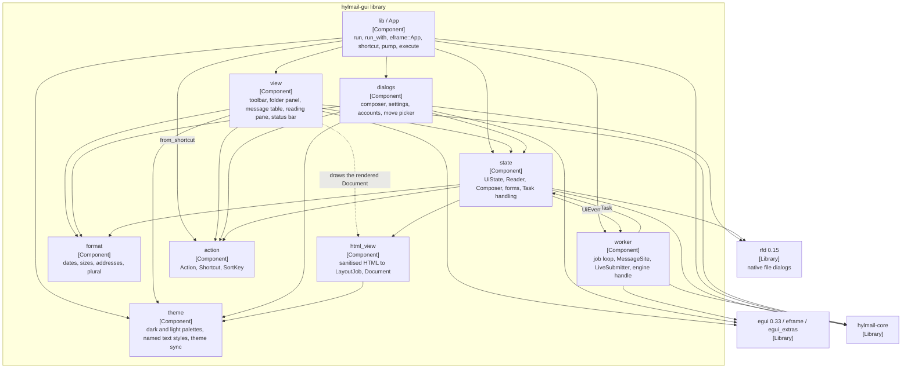

| Component | Owns | May call | Notes |
|---|---|---|---|
| `lib` / `App` | `run`, `run_with`, `App`, the single-instance server, the shortcut map, `pump`, `execute`, `Pane`, `FRAMEWORK`, the window-size constants | every other GUI component, `hylmail-core::{ipc, logging, paths, Core}` | the only place that owns a `Core`; `update` drains the three queues, draws, then executes the collected `Action`s |
| `view` | the five panels, `list_panel` (with the drag source and `Sense::click_and_drag` on the table), the conversation view, `reader_panel` including the invitation card and its answer buttons, the folder drop targets, the pure `folder_rows`/`unread_total` helpers, `PANIC_MESSAGE` | `state`, `action`, `theme`, `format`, and the `html_view::Document` stored in the reader | free of I/O and of `Core`: it reads `UiState` and returns `Action`s; drag-and-drop carries only a `DragMessage` payload |
| `dialogs` | the composer window, the settings dialog, the account dialog including endpoint port and TLS choice, the rule editor, the address book, the move picker | `state`, `action`, `theme`, `format`, `rfd` | modal-in-spirit: it edits a form of `UiState` and returns `Action`s |
| `state` | `UiState`, `Reader`, `Composer`, `ComposeMode`, the form structs (`SettingsForm`, `AccountsForm`, `RulesForm`, `ContactsForm`, `OutboxForm`), `Task`, `handle`, `apply`, `apply_engine`, `flush_sync`, `open_eml`, `move_dragged_to`, `export_eml`, `calendar_reply`, `save_draft`, `process_arrival_rules`, `load_message_images`, `arm_server_search` | `action`, `format`, `html_view`, `rfd`, `hylmail-core::{models, db, store, html, calendar, rules, sync, …}` | owns every decision; `handle` returns `Task`s and never performs I/O itself (the native file pickers are the exception); `flush_sync` re-queries the folder tree and message list once per frame after an engine event, so new mail and a newly discovered account appear without a restart |
| `worker` | `Worker`, the Tokio runtime, the job loop, `MessageSite`, `LiveSubmitter`, the `EngineHandle` with `sync_all`/`reload_accounts`/`refresh_folders`, the `.eml` export, the periodic outbox retry, the remote-image fetch, the server-side search | `state::Task`, `hylmail-core::{sync, outbox, send, body, flags, delete, relocate, oauth, carddav, image, imap, db, store, secrets, net, …}`, `egui::Context` | the only place in the GUI that performs network I/O; reports with `UiEvent` and asks for a repaint |
| `theme` | `DARK_PALETTE`/`LIGHT_PALETTE` and `Palette`, `palette()`, the named text styles, the `icons` vocabulary, `apply`, `sync` | `egui`, `hylmail-core::models` | the single source of colours, type sizes and icons; the dark palette is the default and both themes are installed, so the appearance switch in the settings is a real choice |
| `format` | `format_datetime`, `format_size`, `truncate`, `plural`, `address_label`, `addresses_label` | `hylmail-core::models`, `chrono` | pure functions, unit tested |
| `html_view` | `Document`, `render`, `layout`, `plain_text`, the link list, the image list, `is_remote_source`, the declared-colour parser | `theme`, `egui`, `hylmail-core::html` (as the input type) | turns sanitised HTML into an `egui` layout job; it never fetches anything. `layout` uses the declared colours for a newsletter and the palette for a simple message (`FR-READ-7`) |
| `action` | `Action`, `Shortcut`, `Bindings`, `from_shortcut`, `SortKey` | `hylmail-core::models` | the vocabulary between the UI and `state`; shortcuts are suppressed while a text field has focus, except `Escape` |

`state` and `worker` reference each other: `state` needs `worker::UiEvent` and
`worker` needs `state::Task`.  Those two enums *are* the interface between the
halves, and both live in the same crate, so the cycle is accepted — anything
else would need a third module for two enums.  `view`, `dialogs`, `theme`,
`format`, `html_view` and `action` must not depend on `worker` or on `Core`.

### 3.3 `hylmail-cli` — the two launchers

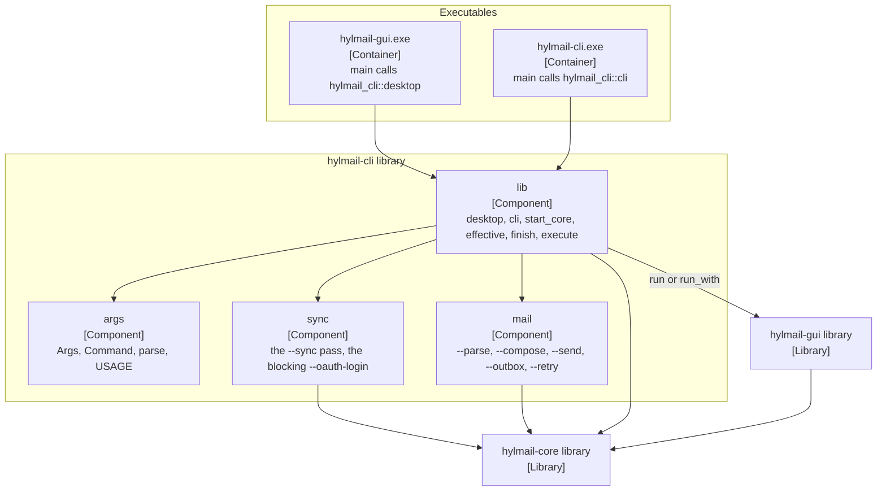

| Component | Owns | May call | Notes |
|---|---|---|---|
| `lib` | `desktop()`, `cli()`, `start_core()`, `effective()`, `finish()`, `execute()`, the shared startup path, `Die` | `args`, `sync`, `mail`, `hylmail_gui::{run, run_with}`, `hylmail-core::{logging, paths, store, secrets, Core}` | resolves the paths, installs the redacting logger and folds a pending crash report in, then dispatches |
| `args` | `Args`, `Command`, `parse`, `USAGE`, `PROG` | — (pure) | the only place that knows the command line; a bare command line is the default for both executables |
| `sync` | the `--sync` single pass, the `--oauth-login` flow | `hylmail-core::{sync, oauth, secrets, store}` | `--oauth-login` is deliberately the one blocking command and never prints the token |
| `mail` | `--parse`, `--compose`, `--send`, `--outbox`, `--retry` | `hylmail-core::{mime, compose, outbox, send, store, paths}` | the scripting surface; the GUI shares the same code paths |

### 3.4 Interactions (what happens on the wire)

The four flows that carry the design.  Each one crosses every trust boundary
named in [§1](#1-level-1--system-context).

**Opening a message.**  The list is served from SQLite, so clicking a row is
instant; only a message whose body was never downloaded needs the network.

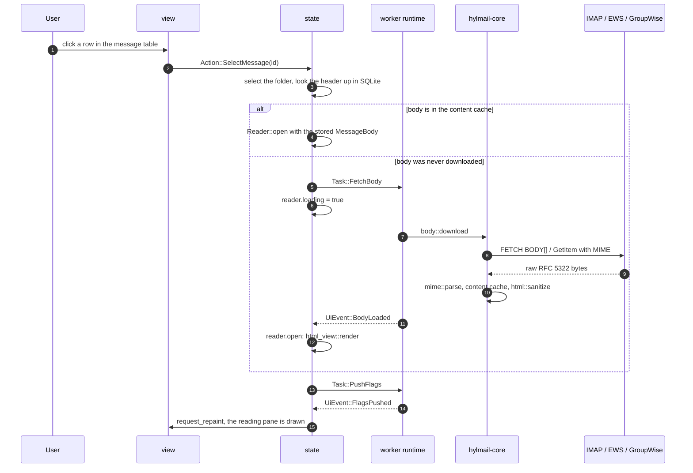

**Sending a message.**  The composer builds bytes, the outbox owns the retry
state machine, `send` picks the submission protocol from the account, and only
the worker talks to a submission server.

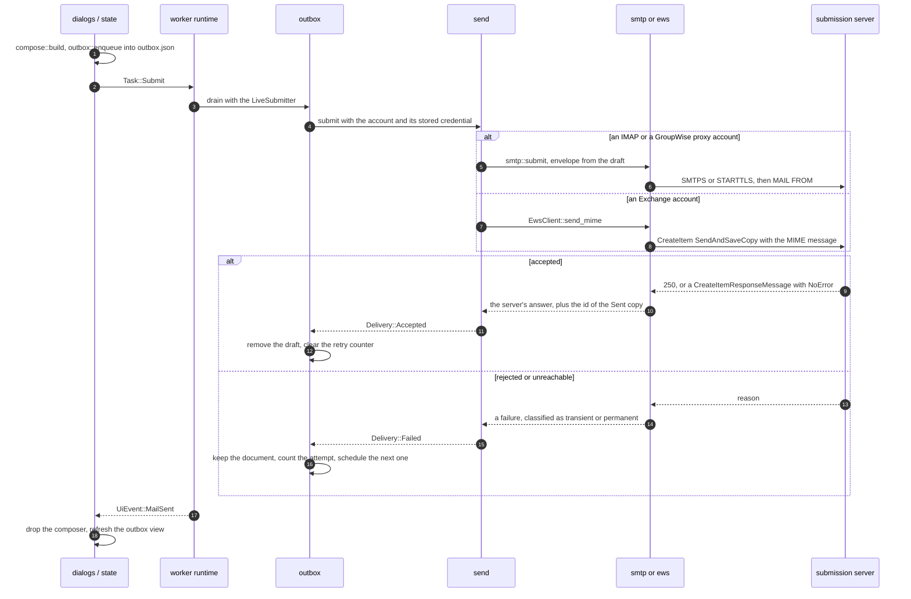

**The synchronisation engine.**  One task per account, supervised; the GUI only
sees `EngineEvent`s.

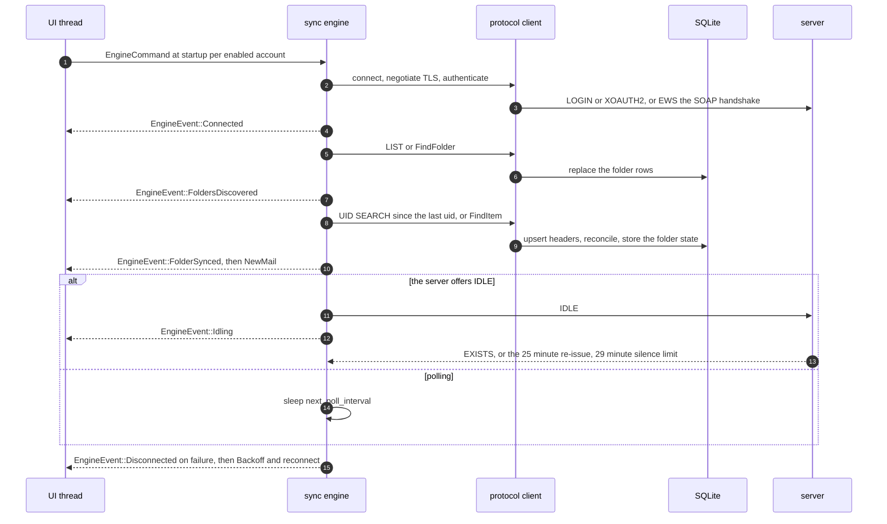

**Account creation.**  Saving the account dialog writes `accounts.json` and
sends `EngineCommand::AccountsChanged`.  The supervisor re-reads the account
list, starts a task for every enabled account that has none and stops the tasks
whose account disappeared, was disabled or was edited; a freshly saved account
therefore connects and synchronises at once.  Each engine event then makes the
window re-query the folder tree and the message list
(`UiState::reload_after_sync`), so the new mail appears immediately instead of
only after a restart.

**OAuth2 with PKCE.**  The only flow that opens a local listener; the token
never leaves the process except into the OS vault.

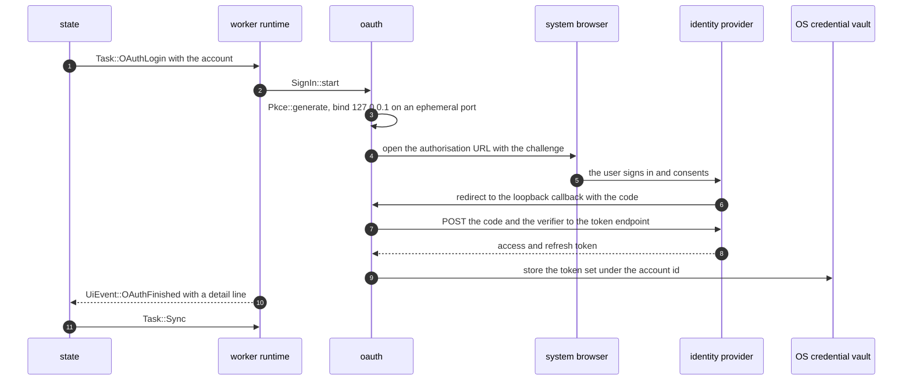

## 4. Dependency laws

These are the rules the architecture stands on.  They are not style
preferences; breaking one of them breaks a documented property of the product.

1. **`hylmail-core` has no UI dependency.**  It never depends on `hylmail-gui`,
   `egui`, `eframe`, `egui_extras` or `rfd`.  All rendering lives in
   `hylmail-gui`, which is why the CLI can run every core feature headlessly.
2. **`models` is the leaf.**  No module inside `models` performs I/O or reaches
   into another component; everything else may depend on it.
3. **One writer per store.**  `store` is the only writer of the JSON documents,
   `db` the only writer of SQLite, `secrets` the only reader and writer of the
   OS vault, `paths` the only place that knows a file location.
4. **Protocol clients do not know each other.**  `imap`, `smtp`, `ews` and
   `groupwise` only share `net`, `soap` and the sync report types.  Everything
   that must work across all three mail systems lives in a feature module
   (`body`, `flags`, `delete`, `relocate`, `send`) and dispatches on `AccountKind` —
   so adding a protocol means touching those five dispatch points, not the GUI.
5. **The engine owns the connection, the GUI owns the interaction.**  No GUI
   component opens a socket, and no core component knows a widget.  They meet in
   `Task`/`UiEvent` and in `EngineCommand`/`EngineEvent`.
6. **The UI thread never blocks.**  Every potentially slow call is a `Task`.  The
   only exceptions are the native file picker and reading a dropped `.eml` file.
7. **Message HTML is hostile.**  It reaches the screen only through
   `html::sanitize` (allow-list) and then `html_view::render`; `html_view` never
   fetches a URL, and remote images stay blocked per message until allowed.
8. **Secrets live in memory and in the vault.**  No credential and no token has a
   file representation, and no log line prints one: the redactor is installed in
   `logging` and covers every field, not only the ones known today.
9. **No transaction across an `await`.**  `Database` is one connection behind a
   lock, shared through `Arc`; the engine and the worker both write to it, so a
   lock guard must never be held over an `.await`.
10. **Failures are values.**  Every public function returns `Result<_, Error>`;
    `unwrap` and `expect` are lint errors in production code and the GUI turns an
    error into text instead of a panic.
11. **NTLM owns a connection.**  NTLM authenticates a connection rather than a
    request, so an NTLM account gets a transport of its own
    (`HttpClient::ntlm`: one connection, HTTP/1.1, handshake per request) instead
    of the pooled one.  The rule is the reason `net::ntlm` exists separately from
    `soap`: the credential computation knows nothing about HTTP, and the
    transport knows nothing about message types.

**One accepted coupling.**  `ews` and `groupwise` reuse `imap::synchronise`'s
report types (`FolderSyncReport`, `SyncProgress`, `SyncDepth`, `SyncOptions`) and
`sync::reconcile::removed_locally`.  This keeps one definition of "what a sync
pass reported", at the price of a dependency from two protocol clients onto the
`imap` module.  A neutral `sync::report` module would be the cleaner home; if
that refactor happens, [§3.1](#31-hylmail-core--the-domain-protocol-and-process-components)
must be updated in the same change.

## 5. Dormant components

**There are none at this revision.**  Every module named in [§3](#3-level-3--components)
is reachable from the running application:

* `rules` is driven by the rule editor and "Regeln jetzt anwenden" in
  `hylmail-gui::state`;
* `image` rasterises inline SVG inside `html::sanitize`;
* `db::conversations` backs the conversation view and is rebuilt by
  `hylmail-gui::state` whenever the view changes;
* `db::contacts` backs the address book, the composer's autocomplete and the
  collection of sent recipients;
* `logging::install_panic_hook` is installed by `hylmail_cli::start_core`, so a
  panic is written to `absturz.txt` and folded into the log on the next start.

This section is kept as the place a component lands when it is written ahead of
its caller; an empty list is the healthy state.  `db::fts` is *not* a candidate:
it is a real internal dependency of `db::messages` and `db::content`.

## 6. Change impact — what to update

| If you … | Update |
|---|---|
| add a protocol or a backend (for example JMAP) | [§1](#1-level-1--system-context) diagram and table, [§2](#2-level-2--containers), the [§3.1](#31-hylmail-core--the-domain-protocol-and-process-components) diagram and table, the dispatch lists in [§4](#4-dependency-laws) law 4, and this table if it lands dormant first |
| add an external system (for example a CalDAV server) | [§1](#1-level-1--system-context) diagram, table and trust boundaries; [§2](#2-level-2--containers) if it needs its own connection |
| add a pane, a dialog or a window | [§3.2](#32-hylmail-gui--the-ui-components) diagram and table |
| add a command-line flag or subcommand | the `args` and `mail` rows of [§3.3](#33-hylmail-cli--the-two-launchers), the `USAGE` text and the README |
| add or move a store or a file | the store table in [§2](#2-level-2--containers), [§2.2](#22-where-state-lives), and the `paths` row in [§3.1](#31-hylmail-core--the-domain-protocol-and-process-components) |
| add a channel between the UI thread and the worker | [§2.1](#21-runtime-topology-of-the-gui-process) |
| add a deployment target or an artifact | [§2.4](#24-deployment-packaging), `packaging/README.md`, the release workflow, and `crates/hylmail-cli/tests/packaging.rs` |
| rename, split or merge a module | the matching table in [§3](#3-level-3--components); the guard test fails until the new name is in this document |
| wire a dormant component | delete its row in [§5](#5-dormant-components), add the edge to the matching diagram, and drop it from the dormant list in `crates/hylmail-cli/tests/architecture.rs` |

## 7. Not covered here

| Topic | Where it lives instead |
|---|---|
| Level 4: types, functions, call graphs | `rust-analyzer` in the IDE, `cargo doc`, and the module tables in [§3](#3-level-3--components) |
| The database schema | `crates/hylmail-core/src/db/migrations.rs` is the schema of record |
| The on-disk JSON schema | the `serde` types in `hylmail-core::models` and `hylmail-core::store` |
| Wire-level protocol detail | the module documentation of `imap`, `soap`, `ews` and `groupwise` |
| Security threat model | not written yet; the trust boundaries in [§1](#1-level-1--system-context) are the architectural part of it |
| Build, packaging and release mechanics | `sys-src/packaging/README.md`, `sys-src/.github/workflows/` |
| Feature status, test counts, roadmap | `sys-src/README.md`; the test suite is the behavioural specification |

## 8. Guard test and how to update this document

`crates/hylmail-cli/tests/architecture.rs` keeps this document honest, and also
guards the structural integrity of [`REQUIREMENTS.md`](REQUIREMENTS.md).  It is a
tripwire, not a proof — it checks claims that a machine can check:

1. **Every top-level module is named here.**  It reads the `mod` declarations of
   `hylmail-core`, `hylmail-gui` and `hylmail-cli` and asserts that each name is
   named *structurally* in `ARCHITECTURE.md`: either as a backticked identifier
   in a table or in prose (`` `send` ``), or as the beginning of a node label in a
   diagram (`send["send …"]`).  A bare occurrence of the word — an `--send`
   on a command line — deliberately does **not** count, which is what keeps a
   short module name from passing by accident.  The check works at the level of
   the first module layer, which is exactly the granularity of the tables in
   [§3](#3-level-3--components).
2. **`hylmail-core` stays UI-free.**  Neither its manifest nor its sources may
   mention `egui`, `eframe`, `egui_extras`, `rfd` or `hylmail-gui`.
3. **The diagrams stay well formed.**  Every Mermaid fence is closed, starts
   with a known diagram keyword, has at least three lines, and every `subgraph`
   in a flowchart has an `end`.
4. **The dormant list stays true.**  For each row of
   [§5](#5-dormant-components) the test asserts that the component is mentioned
   in this document *and* that no non-test source file calls it.  Wiring a
   dormant component therefore fails the test until the row is removed — which is
   what makes the omission visible in review.
5. **The container claims stay true.**  Both executables and all three crates
   must be named, and the two declared `[[bin]]` sections must still match the
   names used above.
6. **The requirement document is structurally intact.**  `REQUIREMENTS.md` must
   exist and carry its section headings, each requirement identifier must be
   defined exactly once, every identifier prefix (`G-`, `FR-`, `BR-`, `NFR-`,
   `AC-`) must be used, and its traceability table must still link into this
   document.

To change the architecture, in this order:

1. change the code;
2. change the diagram that owns the affected level;
3. change the table under it — the tables are the detail, the diagrams are the
   overview;
4. run `cargo test -p hylmail-cli --test architecture` and the four quality gates;
5. say in the commit message which level changed and why.

*Last structural review: this document was written against the tree at version
0.1.0; every module, channel, protocol and artifact named in it was read out of
the source, not from memory.*
